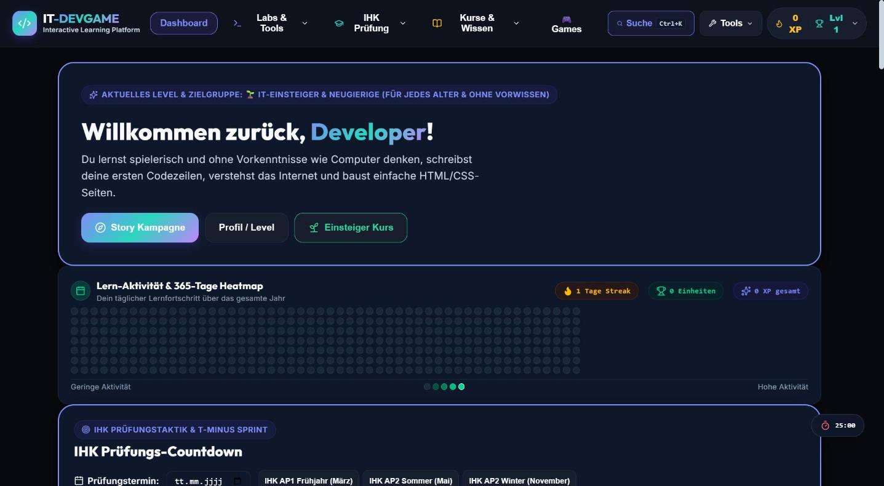
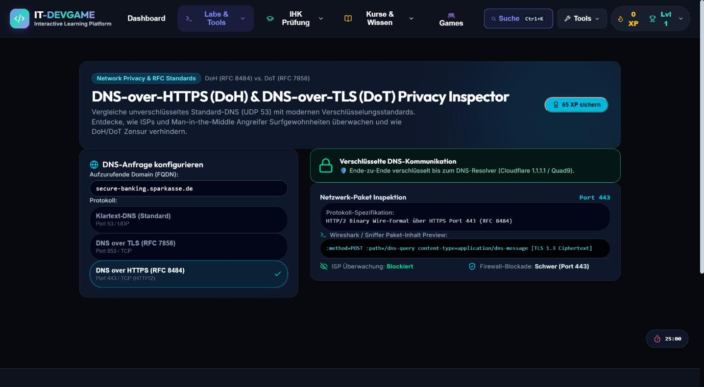

# 💻 IT-DevGame – Informatik-lernen

[](https://github.com/Schengii/Informatik-lernen/actions/workflows/ci.yml) [](LICENSE) [](https://informatik-lernen.vercel.app)  

Interaktive Lernplattform und Prüfungsvorbereitung für Fachinformatiker (FIAE, FISI, FIDP, FIDV, IT-SE) nach IHK-Standard – zugleich ein spielerischer Einstieg in die Informatik ohne Vorkenntnisse.

> 🌐 **Live (Vercel):** <https://informatik-lernen.vercel.app> · PWA, offlinefähig





## 📋 Inhalt
- [Überblick](#-überblick)
- [Ordnerstruktur](#-ordnerstruktur)
- [Funktionsweise](#-funktionsweise)
- [Barrierefreiheit](#-barrierefreiheit)
- [DSGVO & Datenschutz](#-dsgvo--datenschutz)
- [Installation & Befehle](#-installation--befehle)
- [Neues Lab anlegen](#-neues-lab-anlegen)
- [Zusammenarbeit mit Claude & GitHub](#-zusammenarbeit-mit-claude--github)
- [Dokumentation & Änderungshistorie](#-dokumentation--änderungshistorie)

## 🎯 Überblick

| Zielgruppe | Inhalte (Auszug) |
|---|---|
| 🌱 Einsteiger | Einsteiger-Kurs (EVA-Prinzip, CPU, Binärsystem, Internet & DNS), Vokabeln, Quizzes |
| ⚡ IT-Auszubildende | IHK-Lernfelder LF 1–12b, Prüfungssimulator für 5 Berufe, WISO-Kalkulationen, Netzwerk-/Backup-/Projekt-Studios, Noten- & MEP-Rechner, Fachgespräch-Simulator, Spickzettel-PDF |
| 🚀 Junior Developer | Coding-Challenges (Web-Worker-Sandbox), SQL-Sandbox, Git, REST/GraphQL, Docker, CI/CD |
| 🔥 Senior / Architekten | Kubernetes, eBPF, DNSSEC, TLS 1.3, WebAuthn, RAG/LLM, Observability, Linux-Kernel-Themen |

Die **vollständige, automatisch erzeugte Lab-Liste** steht in [`docs/LABS.md`](docs/LABS.md) (Quelle: `src/data/labModulesData.js`, Aktualisierung mit `npm run docs:labs`). Gamification: XP, Level, Badges, Streak, 365-Tage-Heatmap, Spaced Repetition (SM-2), Fehlerjournal.

## 📁 Ordnerstruktur

```
Informatik-lernen/
├── .agents/AGENTS.md          Verweis auf CLAUDE.md für KI-Agenten
├── .claude/                   Claude Code Einstellungen & Slash-Befehle (/test, /verify, /new-lab, /review)
├── .githooks/pre-commit       Sicherheits-Hook (blockiert .env-Dateien & API-Keys)
├── .github/                   CI-Workflow, Dependabot, Issue-/PR-Templates, config.yml
├── docs/                      LABS.md (generiert), README-Archiv.md (alte Feature-Historie bis v3.74.0)
├── e2e/                       Playwright-Tests (Smoke, A11y, PWA, Sandbox, CSP, Lab-Interaktionen)
├── public/                    Statische Assets, PWA-Icons
├── scripts/                   new-lab.js (Lab-Scaffold), gen-lab-list.js (docs/LABS.md), OG-Image, PWA-Icons
├── src/
│   ├── assets/topics/         25 SVG-Diagramme für Wissensartikel
│   ├── components/            Content/ (Labs, TopicReader), Games/, Navigation/, Shared/ …
│   ├── data/                  labRegistry.js, labModulesData.js, topicsData.js, topics/ (24 Artikel)
│   ├── store/                 Zustand-Store (useStore.js) mit LocalStorage-/IndexedDB-Persistenz
│   ├── styles/global.css      CSS-Variablen-Design-System & Markdown-Typografie
│   └── utils/                 *Engine.js (reine Logik), markdownEngine.js, storage, uiPreferences
├── .claudeignore              Token- und Datenschutz-Ausschlüsse für Claude Code & CLI
├── .env / .env.example        Lokale Umgebungsvariablen (Sentry DSN, Port etc.)
├── CHANGELOG.md               Änderungen (Keep a Changelog)
├── CLAUDE.md / GEMINI.md      Leitfaden für KI-Assistenten (GEMINI.md verweist auf CLAUDE.md)
├── PLAN.md                    Priorisierter Umsetzungsplan (Arbeitsgrundlage für alle Maßnahmen)
├── CONTRIBUTING.md            Entwickler- & Beitragsleitfaden
├── SECURITY.md                Sicherheitsrichtlinien & Responsible Disclosure
├── CODE_OF_CONDUCT.md         Contributor Covenant Verhaltenskodex
├── LICENSE                    MIT-Lizenz
├── _Projektuebersicht.md      Projektübersicht
└── vite.config.js, vercel.json, playwright.config.js, tsconfig.json, .oxlintrc.json
```

## ⚙️ Funktionsweise

1. **State (`zustand`)**: XP, Level, Badges, Fortschritt, SM-2-Karten, Aktivitätshistorie, Notizen liegen lokal im Browser (`localStorage`) und werden über `indexedDbStoreMiddleware.js` redundant in IndexedDB gesichert (Schutz vor Quota-Überschreitung / gelöschtem LocalStorage). Tab-übergreifender Sync per BroadcastChannel.
2. **Engine ↔ UI**: Berechnungen stehen als reine Funktionen in `src/utils/*Engine.js` (isoliert getestet), die UI in `src/components/Content/*.jsx` konsumiert sie und vergibt XP.
3. **Lab-Routing**: Jedes Lab ist ein Eintrag in `src/data/labRegistry.js` und wird per `React.lazy` nachgeladen; `labModulesData.js` liefert Metadaten für Dashboard und Command-Palette (bewusst getrennt, damit Icons/Beschreibungen nicht im Haupt-Bundle landen).
4. **Code-Sandbox**: Nutzercode läuft in einem Web Worker (3 s Timeout, kein DOM-/Storage-/Netzwerkzugriff) – kein Rückfall auf den Haupt-Thread. Der Worker hat in `vercel.json` eine eigene CSP (`'unsafe-eval'` nur dort, `connect-src 'none'`).
5. **PWA & Bundle**: `vite-plugin-pwa` mit Precache der App-Chunks; Vendor-Chunks (`react/ui/charts/pdf/sql`) mit `size-limit`-Budgets, schwere Chunks (inkl. des lokal gebündelten Monaco-Editors) per Runtime-Cache.
6. **Audio**: Soundeffekte werden zur Laufzeit per Web Audio API synthetisiert.
7. **Qualität (CI)**: `npm audit` → `lint:ci` → `typecheck` → `test:coverage` (führt alle Tests aus) → `build` → `size` → `e2e`; danach Lighthouse auf dem Build-Artefakt. Smoke- und axe-A11y-Tests rendern jedes Lab automatisch.
8. **Wissensartikel (Wissen)**: 24 modularisierte Lernartikel (`src/data/topics/`) mit sicherer Markdown-Engine (`src/utils/markdownEngine.js`), interaktiven Aufgaben, Quizzes und SVG-Diagrammen (`src/assets/topics/`). Lazy-Loading per dynamischem Import und Deep-Linking (`/wissen/<topicId>`).

## ♿ Barrierefreiheit

Dyslexie-Modus, Farbenblindheits-Modus, Reduced Motion (`prefers-reduced-motion` und `body.reduced-motion`), Schriftgrößen-Skalierung, Text-to-Speech, kein Zoom-Blocker (WCAG 2.1). Einstellungen bleiben unter `informatik_game_ui_prefs_v1` erhalten; ohne eigene Auswahl gelten die Systemvorgaben.

## 🔒 DSGVO & Datenschutz

- Alle Lernfortschritte verbleiben lokal auf dem Gerät.
- Vercel Web Analytics ohne Cookies und ohne IP-Speicherung; optionales Sentry-Monitoring nur mit `VITE_SENTRY_DSN` (siehe `.env.example`).

## 🚀 Installation & Befehle

Voraussetzung: Node ≥ 22.19.

```bash
npm install            # installiert Abhängigkeiten und aktiviert .githooks via "prepare"
git config core.hooksPath .githooks  # manuelle Aktivierung des Sicherheits-Pre-Commit-Hooks
npm run dev            # Entwicklungsserver (http://localhost:5173)
npm test               # Unit-Tests (Vitest)
npm run test:fast      # schneller Testlauf ohne A11y-/Routing-Tests
npm run test:coverage  # Coverage-Report
npm run lint           # Oxlint (CI: lint:ci)
npm run typecheck      # tsc für Dateien mit // @ts-check
npm run build          # Produktions-Build
npm run size           # Bundle-Budgets (nach build)
npm run e2e            # Playwright gegen den Build
npm run new-lab        # Lab-Scaffold (siehe unten)
npm run docs:labs      # docs/LABS.md neu erzeugen
npm run og:image       # Open-Graph Social-Preview-Bild (1200x630) per Playwright erzeugen
```

### 🖼️ Open-Graph Bild generieren

```bash
npm run og:image
```
Rendert die HTML-Vorlage `scripts/og-image-template.html` mit Playwright Chromium und aktualisiert das hochauflösende 1200×630 Vorschaubild unter `public/og-image.png`.

## 🧩 Neues Lab anlegen

```bash
npm run new-lab -- RaidLevel "RAID-Level Studio" hardware Intermediate
```

Das Skript erzeugt Engine, Engine-Test und Lab-Komponente und trägt das Lab am Anfang von `labRegistry.js` und `labModulesData.js` ein. Danach: Engine/UI ausarbeiten, Beschreibung/Tags/Icon anpassen, `npm run docs:labs`, `CHANGELOG.md` und `_Projektuebersicht.md` ergänzen. Details: [CLAUDE.md](CLAUDE.md).

## 🤖 Zusammenarbeit mit Claude & GitHub

Das Repository ist für nahtlose Zusammenarbeit mit Entwicklern und KI-Agenten (insbesondere Anthropic Claude Code und GitHub Actions) optimiert:

- **Umgebungskonfiguration (`.env` & `.env.example`)**: Zentrale Verwaltung optionaler Umgebungsvariablen (wie `VITE_SENTRY_DSN`). `.env` ist in `.gitignore` geschützt.
- **Token- & Kontext-Optimierung (`.claudeignore`)**: Schließt Build-Artefakte, Playwright-Reports, große Lockfiles (`package-lock.json`), Medien und historische Archive (`README-Archiv.md`) vom KI-Kontext aus, um Latenz und Token-Verbrauch drastisch zu senken.
- **Claude Slash-Commands (`.claude/commands/`)**:
  - `/test`: Führt Unit- und Integrationstests gezielt aus und analysiert Testergebnisse.
  - `/verify`: Prüft die komplette 5-stufige CI-Qualitätspipeline (`lint:ci` → `typecheck` → `test` → `build` → `size`).
  - `/new-lab`: Führt durch das Scaffolding und die Erstellung neuer IHK-Module inkl. Tests und Registrierung.
  - `/review`: Überprüft geänderten Code auf Architekturstandards, WCAG 2.1 AA A11y und Security.
- **Sicherheits-Pre-Commit-Hook (`.githooks/pre-commit`)**: Scannt gestagte Dateien und Diffs vor jedem Commit. Blockiert zuverlässig `.env`-Dateien, private Schlüssel (`*.pem`, `*.key`) und versehentlich eingefügte API-Keys (z. B. Anthropic `sk-ant-*`, OpenAI, GitHub PATs, AWS). Automatisch in Git aktiviert via `npm run prepare` (`git config core.hooksPath .githooks`).
- **GitHub Community Standards**:
  - [`CONTRIBUTING.md`](CONTRIBUTING.md): Detaillierter Leitfaden für Mitwirkende und KI-Assistenten.
  - [`SECURITY.md`](SECURITY.md): Richtlinien für Responsible Disclosure und Schutz der Web-Worker-Sandbox.
  - [`CODE_OF_CONDUCT.md`](CODE_OF_CONDUCT.md): Verhaltenskodex nach Contributor Covenant 2.1.
  - Issue- und PR-Templates (`.github/`): Vorlagen für Bug-Reports, Lab-Requests und Qualitäts-Checklisten.

## 📝 Dokumentation & Änderungshistorie

- Änderungen je Version: [`CHANGELOG.md`](CHANGELOG.md)
- Umsetzungsplan & offene Aufgaben: [`PLAN.md`](PLAN.md)
- Lab-Übersicht: [`docs/LABS.md`](docs/LABS.md)
- Beitragsleitfaden: [`CONTRIBUTING.md`](CONTRIBUTING.md)
- Sicherheitsrichtlinien: [`SECURITY.md`](SECURITY.md)
- Ausführliche Feature-Beschreibungen und Änderungshistorie bis v3.74.0: [`docs/README-Archiv.md`](docs/README-Archiv.md)

### Aktuelle Version (v3.79.0) & Neueste Verbesserungen
- **SQL-Labs funktionieren unter der Produktions-CSP**: alasql läuft im eigenen Web Worker (`sql.worker.js`), die Hauptseite bleibt ohne `'unsafe-eval'`.
- **Barrierefreiheit**: Labels sind mit ihren Feldern verknüpft, klickbare Karten per Tastatur (Enter/Leertaste) bedienbar; drei weitere `jsx-a11y`-Regeln sind aktiv.
- **PWA & CI**: Precache 6,1 → 4,1 MB; GitHub Actions auf Node-24-Versionen per SHA gepinnt; Bundle-Trend im PR über `scripts/size-report.js`.
- **Stabilität**: Vitest wieder mit Datei-Isolation, E2E im Gesamtlauf stabil, Lighthouse-A11y gemessen 0,98.
- Umsetzungsstand und offene Punkte: [`PLAN.md`](PLAN.md).

### Version 3.79.0 – Branch-Arbeit M01–M14 (zuvor unveröffentlicht)
- **Modularisierung & Architektur (M08, M10)**:
  - Aufteilung der 901-Zeilen-Komponente `Navbar.jsx` in modulare Unterkomponenten (`NavDesktopMenu`, `NavDropdownMenu`, `NavToolsMenu`, `NavProfileMenu`, `NavMobileDrawer`, `navbarMenuItems.js`) – Haupt-Navbar auf 263 Zeilen verschlankt.
  - Aufteilung der 2.432-Zeilen-Datendatei `labModulesData.js` in 5 thematische Moduldateien unter `src/data/labModules/` (`ihkModules`, `networkModules`, `securityModules`, `cloudDevopsModules`, `softwareDataModules`).
- **Umfassende Testabdeckung & Pilot-Labs (M13)**:
  - 5 neue Interaktions-Test-Suiten für anspruchsvolle Labs: `SubnettingLab.test.jsx`, `VlsmSubnetLab.test.jsx`, `SqlWindowFunctionsLab.test.jsx`, `AlgoPlaygroundLab.test.jsx` und `VectorMathEmbeddingLab.test.jsx`.
  - Alle 234 Lab-Komponenten bestehen automatische axe-core Barrierefreiheitsprüfungen ohne Regelverletzungen (`allLabsA11y.test.jsx`).
- **CI/CD & Lighthouse Härtung (M09, M14)**:
  - Anhebung des Lighthouse CI Mindestschwellwerts für Barrierefreiheit (`categories:accessibility`) auf `0.95` (`lighthouserc.json`).
  - GitHub Actions in `.github/workflows/ci.yml` auf unveränderliche 40-Zeichen Git-SHAs gepinnt (Schutz vor Supply-Chain-Angriffen).
- **Test-Suiten, Vitest-Optimierung & Schwellwerte (M03–M07, M11)**:
  - Neue dedizierte Test-Suiten für Web Audio API (`audioSystem.test.js`), Worker-Sandbox-Evaluator (`sandboxEvaluator.test.js`), Fehler-Monitoring (`errorMonitoring.test.js`) und Sandbox-Test-Utilities (`sandboxTestUtils.test.js`).
  - Erhöhte Vitest-Schwellwerte in `vite.config.js` (Statements 62 %, Branches 53.5 %, Functions 47 %, Lines 63.5 %).
  - `testTimeout: 15000` in `vite.config.js`; `isolate: false` wurde gemessen und wieder verworfen (kein Zeitgewinn, sporadisch rote Tests – siehe `PLAN.md` P05).
- **Pre-Commit-Kompatibilität & Dead-Code-Bereinigung (M01, M02)**:
  - Kapselung und Reformatierung des Mock-RSA-Schlüssels in `jwtConfusionEngine.js` ohne False-Positives im Git Pre-Commit Security Hook.
  - Entfernung toter Datenstrukturen und redundanter Exporte über 22 Utility- und Lab-Module.


### Version 3.78.0 (CSP unter Test, Dialoge, PWA, CI)
- **CSP unter Test**: `vite preview`/E2E liefern die Vercel-Header aus; `e2e/csp.spec.js` prüft Sandbox, YouTube-Player und Monaco ohne CSP-Verstoß. Sandbox-Worker mit eigener CSP, Monaco lokal gebündelt, `script-src` ohne `'unsafe-inline'`.
- **Barrierefreiheit**: Alle Modals sind modale Dialoge mit Focus-Trap, Escape und Fokus-Rückgabe (`Shared/useDialogA11y`); Oxlint prüft jetzt zusätzlich `jsx-a11y`.
- **PWA**: PNG-Icons (192/512/maskable), erzeugt mit `node scripts/generate-pwa-icons.js`.
- **CI**: `npm audit`-Schritt, ein Testlauf statt zwei, Lighthouse ohne zweiten Build, höhere Coverage-Schwellen.
- Umsetzungsstand und offene Punkte: [`PLAN.md`](PLAN.md).

### Version 3.77.0 (Bereinigung, Badges, Härtung & Tests)
- **Pre-Commit-Kompatibilität**: Kapselung und Reformatierung des Mock-RSA-Schlüssels in `jwtConfusionEngine.js` ohne False-Positives im Git Pre-Commit Security Hook.
- **Umfassende Dead-Code- & Export-Bereinigung**: Entfernung ungenutzter Datenstrukturen (`LOGIC_GATES_LEVELS`, `DEFAULT_NET_NAMESPACES`, `RESTART_POLICIES`, `UML_DIAGRAM_TYPES`, `FIDO2_ALGORITHMS`, `NDP_MESSAGE_TYPES`), Kapselung privater Modul-Interna (Entfernen redundanter Exporte über 22 Utility-Module), Bereinigung doppelter Aliase (`PROGRAMMING_LANGUAGES`, `TUTORIAL_VIDEOS`, `evaluateOauth21Flow`) und saubere Re-Exporte in `srsAlgorithm.js`.
- **Sicherheits-Härtung Git Pre-Commit Hook (`.githooks/pre-commit`)**: Aktualisierter und robuster Secret- und .env-Scanner mit automatischer Erkennung von `gitleaks` (bevorzugt) sowie portabler POSIX-Shell-Fallback. Scannt gestagte Diffs selektiv auf API-Keys (`sk-...`, `AIza...`, `ghp_...`, `AKIA...`, `-----BEGIN … PRIVATE KEY-----`, nichtleere Zuweisungen `API_KEY=`, `SECRET=`, `TOKEN=`) und blockiert `.env*` (außer `.env.example`), `*.pem`, `*.key`. Gibt bei Treffern Dateiname und erkanntes Muster aus, maskiert bzw. verschweigt jedoch stets den Geheimwert selbst.
- **Projektweite Bereinigung & Iframe-Härtung**: Beseitigung redundanter Variablen-Aliase (`OsProcessSchedulerLab`), Absicherung der Push-Notification-Instanziierung und Härtung des YouTube-Embeds in `VideoHub` via `sandbox`-Attribute.
- **Vollständige Lab-Mastery-Badges (162 Badges)**: Alle 149 Lab-Mastery-Badges aus `src/data/labRegistry.js` sind jetzt lückenlos in der globalen Badge-Tabelle (`src/utils/storage.js`) definiert und werden im `BadgesModal` fehlerfrei angezeigt.
- **CI & Oxlint-Bereinigung**: Vollständige Beseitigung aller Linter-Warnungen im CI-Modus (`npm run lint:ci --deny-warnings`) über 704 Dateien (Immutabilitätsmuster, React-Purity-Regeln, Timer-Callbacks).
- **Gamification & Spaced Repetition**: Synchronisation von `Sm2SpacedRepetitionLab` mit `userState.srsFlashcards`, Vermeidung von Endlos-XP-Gains durch Deckelung und saubere XP-Prop-Verdrahtung in `FlashcardsModal`.
- **Architektur & Komponenten-Entkopplung**: Striktes Props-First-Prinzip bei `IhkCheatSheetPdfGenerator`, `LinuxMemoryLab` und `ZkpCryptoVisualizerLab`. Auslagerung von `mapQuestionToLernfeld` als reine Engine-Funktion nach `ihkWeaknessAuditEngine.js`.
- **Sicherheit & Härtung**: Web-Worker-Scope Lockdown um `WebAssembly` und `SharedArrayBuffer` gehärtet; Beseitigung des `Date.now()` Hotspots im Token-Rendering.
- **Barrierefreiheit (WCAG 2.1 AA)**: Semantische Modal-Rollen (`role="dialog"`, `aria-modal="true"`, `aria-labelledby`) und `Escape`-Tastaturunterstützung in `BadgesModal` und `FlashcardsModal`.
- **Test-Suiten**: Neue isolierte Test-Suiten für Flashcards-Sortierung (`FlashcardsModal.test.jsx`), Push-Notifications (`pushNotificationManager.test.js`) und Lernfeld-Mapping (`ihkWeaknessAuditEngine.test.js`).

### Version 3.76.0 (IHK Prüfungsplaner & Schwachstellen-Audit)
- **IHK Prüfungs-Countdown & Adaptiver Lernplaner (`ihk_study_plan_lab`)**: Dynamische Prüfungstermine für FIAE, FISI, FIDP, FIDV, IT-SE und ITSM, UTC-sichere Countdown-Berechnung, kanonische Prüfungssimulations-Verlinkung, Wochenplan-Roadmap mit Fortschritts-Persistenz im `userState` (`studyPlanWeeks`) und WCAG 2.1 AA konformes Styling mit ARIA-Listen.
- **IHK Schwachstellen-Audit Assistent (`ihk_weakness_audit_lab`)**: Reale Lernfeld-Fehleranalyse (LF 1–12) direkt aus dem Fehlerjournal (`userState.mistakeJournal`), gezielte Lab-Wiederholungs-Empfehlungen und interaktive Simulation.
- **Zentrale Registry & Komponenten-Entkopplung**: Beide Labs sind über `src/data/labRegistry.js` registriert und konsumieren Standard-XP- und Navigations-Props ohne unkontrollierte Store-Kopplung.
- **Spaced Repetition Flashcards (`FlashcardsModal`)**: Priorisierte Darstellung fälliger Karten nach dem SuperMemo-2 (SM-2) Algorithmus (`dueDate <= today`) und valider TSV-Export für Anki.
- **Projekt- & Code-Bereinigung**: Entfernung ungenutzter Starter-Template-Dateien (`src/App.css`, `src/assets/`, `public/icons.svg`), Eliminierung toter Komponenten (`AccessibilityToolbar.jsx`) und Verschlankung von `App.jsx`.
- **Sicherheit & Git Pre-Commit Hook**: Automatischer Secret- und .env-Scanner in `.githooks/pre-commit` (in Git aktiviert über `core.hooksPath .githooks` und `npm run prepare`).
- **Claude- & GitHub-Integration**: `.env`, umfassend erweiterte `.claudeignore`, Claude Slash-Commands (`/test`, `/verify`, `/new-lab`, `/review`), `CONTRIBUTING.md`, `SECURITY.md`, `CODE_OF_CONDUCT.md` und Issue-Template-Konfiguration.
- **Dokumentation**: README von rund 2100 auf wenige Dutzend Zeilen verschlankt; frühere Fassung unverändert unter `docs/README-Archiv.md`.
- **Tooling**: `npm run new-lab` (Lab-Scaffold) und `npm run docs:labs` (automatisch erzeugte Lab-Liste).

---

## 📄 Lizenz

Dieses Projekt steht unter der [MIT-Lizenz](LICENSE).
